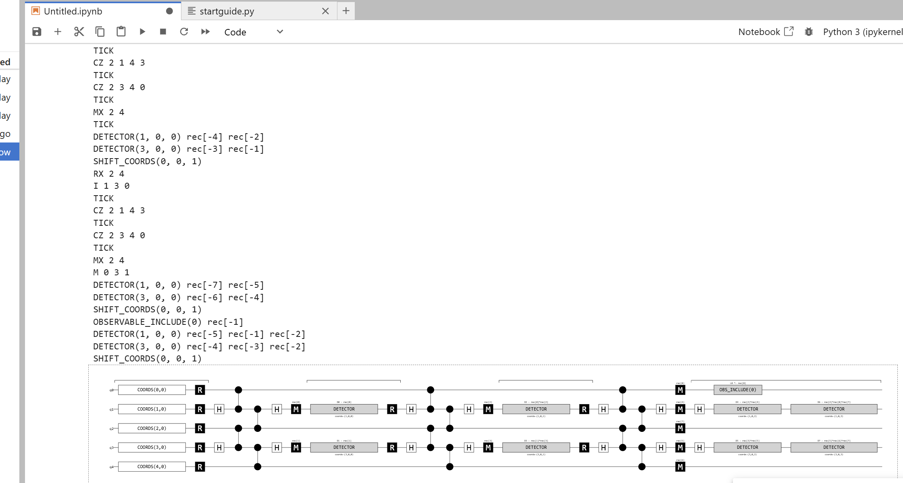
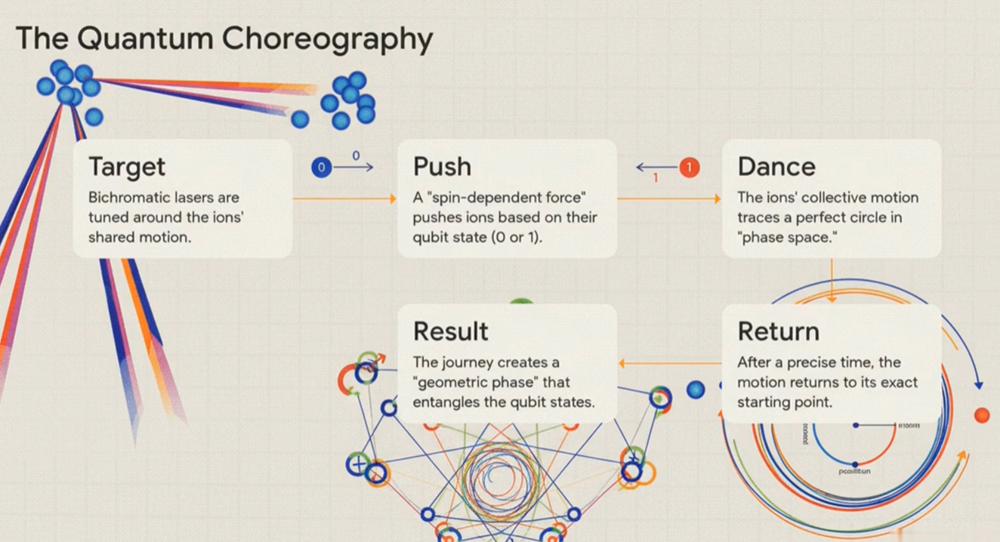

ancilla qbits act as helpers

distance 3 means there is |q1|-|a1| -|q2| -|a2|-|q3|

so 5 total

shows in docs :

.. code-block:: text

        0├    o --- Z/X --- o --- Z/X --- o
         |
         └----┴------┴------┴------┴------┴
              0      1      2      3      4

Z checks catch X and X chcks catch Z?

ancilla results -> syndrome

# analysing circuit output:

QUBIT_COORDS(4, 0) 0
QUBIT_COORDS(0, 0) 1
QUBIT_COORDS(1, 0) 2
QUBIT_COORDS(2, 0) 3
QUBIT_COORDS(3, 0) 4
R 0 3 1  -- resets data qbits
RX 2 4   -- resets ancillas
TICK
I 1 3 0
TICK
CZ 2 1 4 3
TICK
CZ 2 3 4 0
TICK
MX 2 4
TICK
DETECTOR(1, 0, 0) rec[-2]
DETECTOR(3, 0, 0) rec[-1]
SHIFT_COORDS(0, 0, 1)
RX 2 4
I 1 3 0
TICK
CZ 2 1 4 3
TICK
CZ 2 3 4 0
TICK
MX 2 4
TICK
DETECTOR(1, 0, 0) rec[-4] rec[-2]
DETECTOR(3, 0, 0) rec[-3] rec[-1]
SHIFT_COORDS(0, 0, 1)
RX 2 4
I 1 3 0
TICK
CZ 2 1 4 3
TICK
CZ 2 3 4 0
TICK
MX 2 4
M 0 3 1
DETECTOR(1, 0, 0) rec[-7] rec[-5]
DETECTOR(3, 0, 0) rec[-6] rec[-4]
SHIFT_COORDS(0, 0, 1)
OBSERVABLE_INCLUDE(0) rec[-1]
DETECTOR(1, 0, 0) rec[-5] rec[-1] rec[-2]
DETECTOR(3, 0, 0) rec[-4] rec[-3] rec[-2]
SHIFT_COORDS(0, 0, 1)

# Mølmer–Sørensen gate :

(MS gate)

Watched a Quantum "Deep Dive" Podcast video on it

## My notes/ideas on it:

### Quantum challenge

"Entanglement is the operative currency of a qpu"

more precision

Ions - atoms with electric charge

Trapped Ions are nearly perfect, identical qubits

can be held in stable electromagnetic traps

Even though trapped separately, they can communicate with -phonons- which are shared vibrations as all the ions are sitting in the same trap.

Acts as  ahigh speed communication channel for qubits

"Quantum databus"

Gate that is robust against motion? 

MS gate: universal entangler designed for real world messy scalable experiments

### How it works

Uses Lasers

Bichromatic lasers - 

Two laser frequencies, tuned symmetrically just above and below a key of vibrational frequency of the ions

journey creates a geometric phase which entangles the qubit states

What about exact time? how ensured and/or calculated

### Practical advantages

robust against heat can entangle many qubits simultaneously

does not need to be cooled to milli Kelvin

there is >99.9% accuracy so only 1/1000 are errors

Smashes through fault tolerance threshold of 1%

